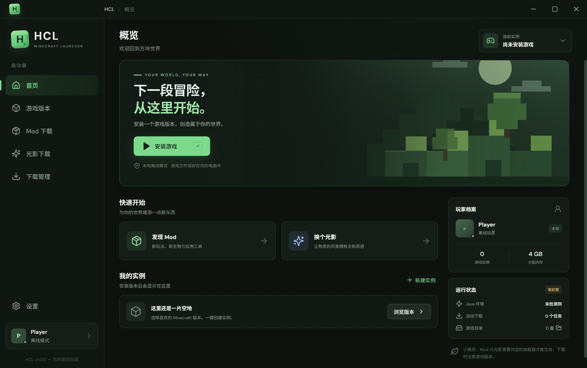

# HCL - Minecraft 启动器

一个简洁、清爽的 Minecraft 启动器。专注于游戏与社区内容，不做多余的事情。

当前版本 **v2.1.2** · [下载](https://github.com/houshibo0101/HCL/releases/latest) · [文档](https://github.com/houshibo0101/HCL/wiki) · [问题反馈](https://github.com/houshibo0101/HCL/issues)



## 功能

- **游戏版本下载** — 接入 Mojang 官方版本源，一键下载客户端、运行库和资源文件，支持正式版 / 快照 / Beta / Alpha；下载完成后按官方 SHA1 校验，损坏文件自动重下
- **五种加载器实例** — 原版 / Fabric / Forge / NeoForge / Quilt，创建时一键选择；Forge 与 NeoForge 走官方安装器（BMCLAPI 国内镜像兜底），每个实例拥有独立的存档、Mod 与光影
- **光影一键就绪** — 创建 Fabric / Quilt 实例时可顺手装好 Iris + Sodium，装完直接挑光影包
- **Mod 下载** — 接入 [Modrinth](https://modrinth.com)，按游戏版本和加载器筛选，支持中文搜索（内置中英词表），直接下载到实例的 `mods` 文件夹
- **光影下载** — Modrinth 光影资源浏览与下载，保存到实例的 `shaderpacks` 文件夹
- **共享游戏资源** — 所有实例共用一份 `assets` / `libraries`，同版本建多个实例不再重复占磁盘（旧实例首次启动自动迁移）
- **下载管理** — 后台多任务下载、断点续传（断网后从断点继续）、实时进度、取消、失败日志
- **本地实例管理** — 实例切换 / 删除（移入回收站）、一键打开实例目录
- **启动设置** — 离线玩家名、内存分配、Java 自动检测与自定义路径
- **启动加速** — 启动前自动压缩系统内存工作集，设置页可手动立即优化（仅 Windows）
- **应用内更新** — 三处检查入口（首页状态卡 / 侧栏版本号 / 设置→关于），启动自动检查、运行中每 2 小时复查，发现新版本主动提示、后台下载、重启自动安装；国内自动切换镜像
- **外观主题** — 「钢蓝」设计系统 + 6 套强调色主题（翡翠绿/穹际蓝/星辉紫/暖阳橙/樱花粉/薄荷青），设置页一键切换、即时生效
- **窗口尺寸** — 默认 1180×760 居中启动，不再铺满屏幕，可自由缩放
- **游戏语言自动汉化** — 启动前自动写入简体中文语言设置，新实例首次进入即为中文界面
- **皮肤站账户登录** — 支持 LittleSkin 及任意 Yggdrasil 服务器（外置登录），多账户管理，进入在线服务器验证身份
- **联机** — 局域网 IP 一键复制；集成 cpolar 免费内网穿透隧道，跨网络联机

## 快速开始

1. 从 [Releases](https://github.com/houshibo0101/HCL/releases) 下载 `HCL-Setup-2.1.2.exe`（或 `release/win-unpacked/HCL.exe` 绿色版）
2. 安装并运行；Windows SmartScreen 提示时选择“更多信息 → 仍要运行”（安装包未做代码签名）
3. 在“游戏版本”页选择版本创建实例，然后回首页点击“启动游戏”

> 系统要求：Windows 10/11（64 位）或 macOS 12+。Java 无需手动准备：1.16.5 及以下需要 Java 8，1.17–1.20.4 需要 Java 17，1.20.5 及以上需要 Java 21，启动器会自动匹配并下载。macOS 安装包由 GitHub Actions 自动构建（未签名，首次打开需右键 → 打开）。

## 数据目录

Windows 默认所有游戏数据保存在 D 盘（没有 D 盘时落到 `%APPDATA%\HCL\data`）：

```
D:\HCL\data
├── shared\assets\            # 游戏资源（所有实例共用，按哈希去重）
├── shared\libraries\         # 运行库（所有实例共用）
├── games\instances\<实例>\   # 游戏实例（versions / mods / shaderpacks / saves）
├── runtime\                  # 自动下载的 Java（java-8 / java-17 / java-21）
├── logs\error.log            # 下载/安装失败日志
├── settings.json             # 启动器设置
├── instances.json            # 实例列表
└── accounts.json             # 游戏账户（离线 / 皮肤站）
```

> 2.0.0 起 `assets` / `libraries` 由全局共享目录统一管理：同一版本建多个实例只占一份资源，旧实例首次启动会自动迁移。

## 从源码构建

```bash
git clone https://github.com/houshibo0101/HCL.git
cd HCL
# 国内网络建议使用镜像
npm install --registry=https://registry.npmmirror.com
# Electron 二进制建议走镜像
set ELECTRON_MIRROR=https://npmmirror.com/mirrors/electron/

npm run dev     # 开发调试
npm run build   # 构建前端（生产构建自动注入 CSP）
npm run dist    # 打包 Windows 安装程序（输出到 release/）
npm run lint    # ESLint（electron/、src/ 含 .jsx、scripts/）
npm test        # 单测（版本号 / Java 匹配 / 离线 UUID / 架构映射 / 资源迁移）
npm run docs    # 从 wiki/ 生成 docs/（GitHub Pages 版本）
npm run capture # 批量截取各页面，用于 UI 改动前后对比
```

变更历史见 [CHANGELOG.md](CHANGELOG.md)，许可证为 [MIT](LICENSE)。

详细文档见 [Wiki](https://github.com/houshibo0101/HCL/wiki)，或阅读 `docs/`（由 `npm run docs` 从 wiki 生成）。

## 技术栈与数据来源

- Electron + React + Vite
- 游戏版本：Mojang 官方 version manifest / piston-meta
- Mod / 光影：Modrinth API
- Fabric / Quilt 加载器：FabricMC / QuiltMC meta API
- Forge / NeoForge 加载器：官方 Maven + BMCLAPI 镜像
- Java 运行时：Adoptium（国内走清华 TUNA 镜像）

## 免责声明

Minecraft 是 Mojang Synergies AB 的商标。HCL 不是官方 Minecraft 产品，与 Mojang 或 Microsoft 无隶属关系。
