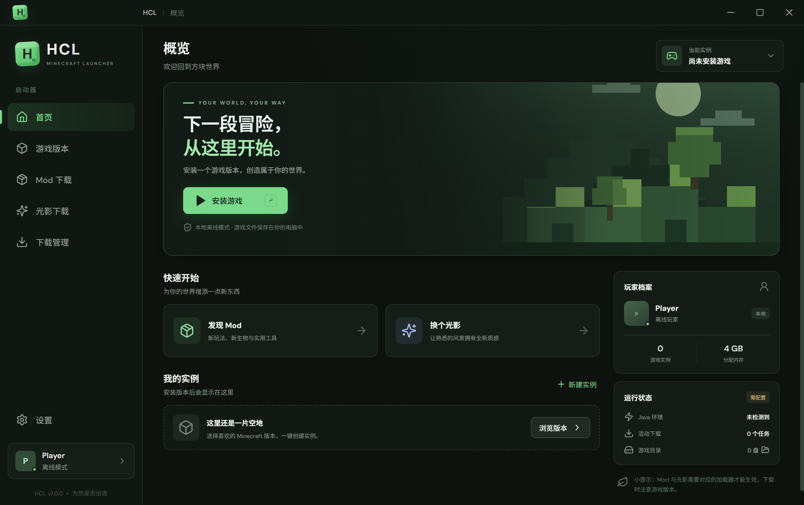

# HCL 启动器文档（Wiki 百科）

**HCL** 是一个简洁的 Minecraft 启动器：官方版本下载、Modrinth Mod/光影下载、原版与 Fabric 实例管理，所有数据保存在 D 盘。

## 文档目录

| 页面 | 内容 |
| --- | --- |
| [安装指南](Installation.md) | 系统要求、安装步骤、目录结构 |
| [使用指南](Usage.md) | 版本安装、Mod/光影下载、实例与下载管理 |
| [常见问题 FAQ](FAQ.md) | Java、SmartScreen、下载失败排查 |
| [开发与构建](Development.md) | 环境搭建、构建命令、项目结构、外部 API |

## 功能一览

- **游戏版本下载** — Mojang 官方版本源，正式版 / 快照 / Beta / Alpha
- **Mod 下载** — Modrinth，按游戏版本与加载器筛选，直下到实例 `mods`
- **光影下载** — Modrinth 光影，保存到实例 `shaderpacks`
- **实例管理** — 原版 / Fabric，独立存档、Mod、光影
- **下载管理** — 后台多任务、失败日志
- **启动设置** — 离线玩家名、内存、Java 检测

## 相关链接

- 仓库主页：<https://github.com/houshibo0101/HCL>
- 问题反馈：<https://github.com/houshibo0101/HCL/issues>

## 免责声明

Minecraft 是 Mojang Synergies AB 的商标。HCL 不是官方 Minecraft 产品，与 Mojang 或 Microsoft 无隶属关系。
